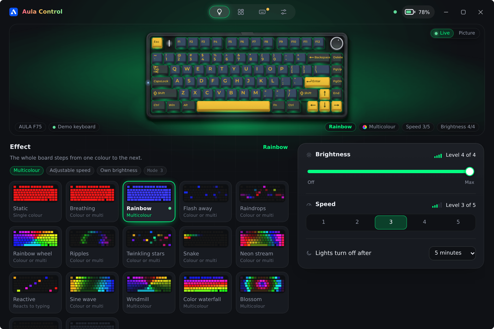
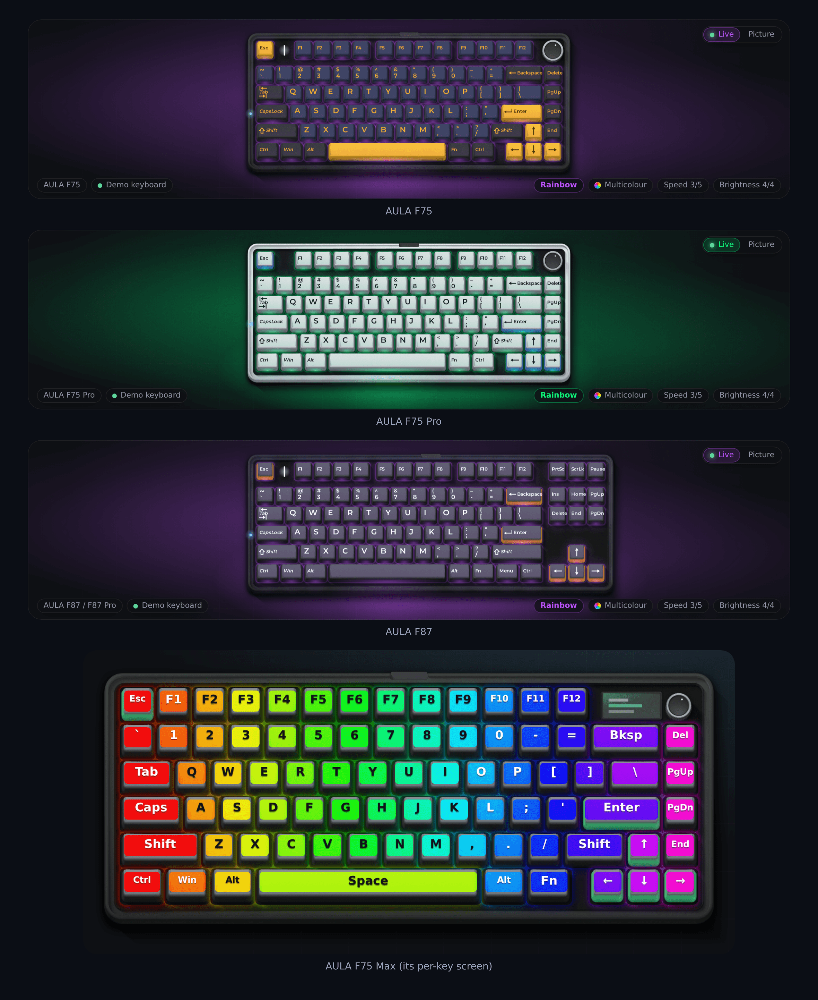
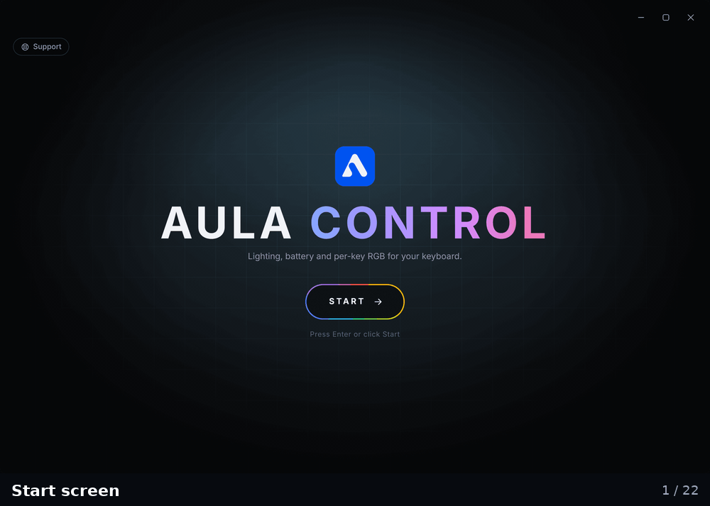

<!--
  KEEP THE SCREENSHOTS UP TO DATE (note for anyone who edits this project, people and AI assistants alike).

  Whenever the UI changes in any way (layout, colours, text, icons, a tab, setting, dialog or screen added, moved,
  renamed or removed), the screenshots in docs/screenshots must be updated in the same change, and the gallery in
  the "Screenshots" section below must match them:

    1. Existing screen changed: run   npm run screenshots   and commit the new pictures.
    2. New screen or state: add a scene for it in scripts/screenshots.js, run the script, and add the new
       picture to the "Screenshots" section below.
    3. Screen removed: delete its scene and its picture, and remove it from the "Screenshots" section.

  One-time setup:  npm install --no-save playwright sharp   then   npx playwright install chromium
  (sharp is optional; it makes the pictures about 4x smaller). `npm run screenshots -- --list` shows the scene
  names, and `npm run screenshots -- lighting battery` redraws only those. The pictures show the real UI with a
  simulated keyboard, so no hardware is needed. `npm test` checks that every picture in the folder is used here
  and every picture used here exists.

  The auto-playing slideshow in the "Screenshots" section is one animated picture, docs/slideshow.gif (GitHub does
  not run JavaScript in a README, so it cannot have arrows). After the screenshots change, rebuild it with
  `npm run slideshow` (needs Python, Pillow and ffmpeg; the slide list is at the top of scripts/make-slideshow.py)
  and commit it. Keep the "All screenshots in full size" list below it in step with docs/screenshots.
-->

<!--
  BUMPING THE VERSION (note for anyone who edits this project, people and AI assistants alike).

  When the version is bumped, change only the version number: in package.json ("version") and in the Version
  badge below (the X.Y.Z in badge/version-X.Y.Z-blue). The only other edit is the new header at the top of
  RELEASE_NOTES.md (see the note at the top of that file). Change nothing else: no README text, no screenshots,
  no tests. `npm test` checks that the two numbers agree.
-->

<div align="center">


**An unofficial Windows and Linux app for AULA F75 keyboards.**<br>
Battery, lighting effects, per-key RGB and a live preview.

[](../../releases)
[](#download)
[](https://discord.gg/BdeQygyRwN)

[**Download**](../../releases) · [Features](#features) · [Screenshots](#screenshots) · [Troubleshooting](#troubleshooting) · [Discord](https://discord.gg/BdeQygyRwN)



</div>

## New: Liquid glass UI (experimental)

A second look for the app: panels, buttons, sliders and switches become glass that blurs and bends the picture behind
them, a bit like iOS. **Classic** is still the default.

- **Choose it:** the first time you press **Start**, the app asks "Which UI do you want to use?" and shows both looks.
  Pick one and press **Continue**. You can change it any time in **Settings > Theme > UI**.
- **Three looks:** **Clear glass** (no blur), **Blur glass** (soft blur, the default) and **Frosted glass** (heavy blur).
  Press **Customise** for sliders (blur, edge width, refraction, colour fringe). **Reset** goes back to Blur glass.

<div align="center">


<sub>The Lighting tab in Liquid glass, over the built-in background picture</sub>

</div>

> [!CAUTION]
> **Experimental:** it is **not stable** and **can be laggy**, more so on older computers, and it may glitch in places.
> It looks best with a background picture (Settings > Theme). If anything misbehaves, switch back to **Classic** in the
> same place. Nothing else is affected.

## Read this first

I made this app for myself because AULA's official software is bad and its UI is terrible. I'm sharing it for anyone
who wants to try it. It's free, and you use it on your own.

I don't even know coding, so **use it at your own risk**, or leave if you have any issue. It was made with the help of
AI. If you have a personal problem with that, you're free to leave. I'm not earning anything from it, so I don't need to
worry about it. I just want to share.

**Tested only on the AULA F75.** Every other model (F75 Pro, F87, F75 Max) is untested, so I don't know if it works.
If you get an error, comment on the release.

Not affiliated with AULA.

## Download

Everything is on the [Releases](../../releases) page.

**Windows 10 / 11**

1. Download **Aula-Control-Setup.exe** and run it. No admin needed. (Or **Aula-Control-Portable.exe**, which needs no install.)
2. If Windows warns about an unknown publisher (the app isn't code-signed), choose **More info**, then **Run anyway**.

No keyboard? Try the demo: **Settings, Demo keyboard**, or click the Aula logo and choose **Demo F75 Max**.

To uninstall, use Windows Settings, Apps. That also deletes the app's data (your settings and what it remembers);
updating keeps it. The portable build has no uninstaller, so delete its data folder yourself.

**Linux (64-bit, new and untested)**

- **Ubuntu, Debian, Mint, Pop!_OS:** download **Aula-Control-amd64.deb**, double-click it and press Install (or run
  `sudo apt install ./Aula-Control-amd64.deb`). Then unplug and plug the keyboard once.
- **Any other distro:** download **Aula-Control-x86_64.AppImage**, right-click it, Properties, allow executing as a
  program, then double-click it. The AppImage cannot set up keyboard access itself, so also download
  **99-aula-control.rules** from the same release and run this, then unplug and plug the keyboard:

  ```
  sudo cp 99-aula-control.rules /etc/udev/rules.d/ && sudo udevadm control --reload-rules && sudo udevadm trigger
  ```

## Community

Join the [Discord server](https://discord.gg/BdeQygyRwN) to share ideas, ask for help or tell us about a problem. Ideas for new features are welcome.

In the app, press **Support** (on the start screen and in the top bar) for the Discord invite and the other links.

## Features

**By keyboard model** (✅ yes, ❌ no)

| Feature | F75 | F75 Pro | F87 | F75 Max |
| :-- | :-: | :-: | :-: | :-: |
| Lighting effects (15; 20 on the F75 Max) | ✅ | ✅ | ✅ | ✅ |
| Per-key RGB | ✅ | ✅ | ✅ | ✅ |
| Live preview as a rendered picture of your model | ✅ | ✅ | ✅ | ✅ |
| Battery level | ✅ | ✅ | ✅ | ✅ |
| Key assignment (experimental) | ✅ | ✅ | ✅ | ❌ |
| Tested by the author | ✅ | ❌ | ❌ | ❌ |

**By connection**

| Feature | 2.4G dongle | USB-C cable | Bluetooth |
| :-- | :-: | :-: | :-: |
| Lighting effects and per-key RGB | ✅ | ✅ | ❌ |
| Key assignment (experimental) | ✅ | ✅ | ❌ |
| Battery level | ✅ | ❌ | ✅ |

**The app**

| Feature | Windows | Linux |
| :-- | :-: | :-: |
| Dark and light themes | ✅ | ✅ |
| Tray icon | ✅ | ✅ |
| Start with Windows | ✅ | ❌ |
| Updates itself (installed version) | ✅ | ❌ |

- **Battery:** level, charging indicator, and low / fully charged alerts, with a red breathing light on the keyboard while the battery is low. The USB-C cable reports no level (it only shows that it is charging). Over Bluetooth the level comes from Windows, and Windows does not let apps change lighting over Bluetooth.
- **Live preview:** has a Live / Picture switch. Live follows the keyboard and goes dark when it is off or asleep. Picture is only a still image of the board in its current light colours, with no animation, no pointer effects and nothing laid over it.
- **Key assignment:** on the F75 Max the same tab is its own Keyboard section instead.
- **After an update**, a small window lists what is new (only the headers from RELEASE_NOTES.md, not the descriptions). The portable build and Linux do not update themselves: they tell you a new version is out and open the release page.
- **Liquid glass UI** (experimental, not stable, can be laggy): an optional second look, offered once after Start ("Which UI do you want to use?") and in Settings > Theme > UI. Classic stays the default.
- **Blur switch** (Classic UI only): Settings > Theme > Blur turns the frosted blur behind the tabs, cards, tiles and pop-ups on or off.



## Screenshots

The picture at the top is the Lighting tab. Here is the rest of the app, one picture every 3 seconds (all of these are the
real app with a simulated keyboard: the Demo keyboard, or a simulated dongle, cable or F75 Max):

<div align="center">



</div>

<details>
<summary><b>See every screenshot full size</b> (tap to open)</summary>

<br>

**Start and devices:** [Start screen](docs/screenshots/start.png) · [Which UI do you want to use?](docs/screenshots/style-picker.png) · [Connected devices](docs/screenshots/devices.png)

**Lighting and per-key:** [Lighting](docs/screenshots/lighting.png) · [Lighting in Liquid glass](docs/screenshots/lighting-glass.png) · [Apply, the transfer animation](docs/screenshots/sending.png) · [Per-key](docs/screenshots/per-key.png) · [The light theme](docs/screenshots/light-theme.png)

**Keys (experimental):** [Key assignment, Caps Lock changed to F13](docs/screenshots/keys.png)

**Battery:** [Battery level, estimate and history](docs/screenshots/battery.png) · [Charging over the 2.4G dongle](docs/screenshots/charging.png) · [Charging over the USB-C cable](docs/screenshots/charging-cable.png)

**Settings:** [Keyboard](docs/screenshots/settings.png) · [App](docs/screenshots/settings-app.png) · [Theme](docs/screenshots/settings-theme.png) · [Debugging](docs/screenshots/settings-debug.png)

**When the keyboard is not ready:** [Reading the keyboard](docs/screenshots/connecting.png) · [The keyboard is asleep](docs/screenshots/asleep.png)

**Support, updates and window buttons:** [Support menu](docs/screenshots/support.png) · [Software update](docs/screenshots/update.png) · [Window buttons](docs/screenshots/window-controls.png)

**F75 Max (experimental):** [Lighting, 20 effects](docs/screenshots/max.png) · [Per-key colours](docs/screenshots/max-perkey.png)

**Every model:** [The picture for each model](docs/screenshots/keyboards.png)

</details>

## Troubleshooting

- Close the official AULA driver. Only one program can use the keyboard at a time.
- Lighting works over the 2.4G dongle (best) or USB-C cable. Bluetooth only gives the battery level.
- The red low-battery light is written by the app, so it only works while Aula Control is running. Hidden in the tray is fine; if you quit the app, nothing watches the battery. Turn on **Start with Windows** in Settings, App to keep it running. Hover the tray icon to see what the app uses right now (CPU and memory, measured by Electron).
- Still stuck? Open **Settings, Connection help** and save a log.

---

*Made with the help of AI.*
